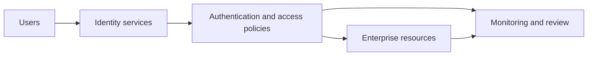

<h1 align="center">kumar3golu</h1>

<strong>IT Professional | Identity & Access Management | Enterprise IT Infrastructure | IT Operations</strong>

---

## Professional focus

IT professional with a career focus on identity and access management, enterprise infrastructure and IT operations. This portfolio is intended to share technical documentation, practical learning labs and operational resources.

## Areas of interest

| Domain | Topics |
| --- | --- |
| Identity & Access Management | Identity lifecycle, access governance, authentication and authorization |
| Enterprise Infrastructure | Directory services, infrastructure reliability and administration |
| IT Operations | Incident management, service continuity, troubleshooting and documentation |
| Operational Improvement | Service quality, process improvement and knowledge management |
| Identity Security | Least privilege, Zero Trust and access controls |

These topics describe portfolio interests rather than a verified list of certifications or technical competencies.

## Identity and access reference architecture

Conceptual reference architecture for learning, not a production deployment.

## Featured repository

**[IAM Zero Trust Lab](https://github.com/kumar3golu/iam-zero-trust-lab)**

## Planned portfolio resources

- Identity lifecycle and access review checklists
- Enterprise directory services operational runbooks
- Incident management and escalation templates
- Infrastructure health check documentation
- IT service improvement and knowledge management guides

## Professional principles

- Security and least privilege
- Reliable IT services and clear operational processes
- Continuous improvement and practical documentation

## GitHub activity

[Repositories](https://github.com/kumar3golu?tab=repositories) · [Contribution history](https://github.com/kumar3golu#js-contribution-activity)

## Collaboration and opportunities

Interested in opportunities and collaboration in IAM, enterprise IT infrastructure, IT operations and operational management.
