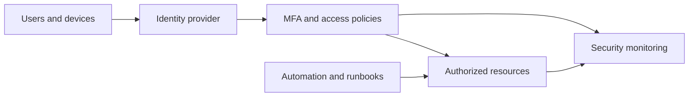

<h1 align="center">kumar3golu</h1>

<strong>◆ IT Infrastructure · Identity Security · Cloud · Automation ◆</strong>

---

## Professional focus

IT professional interested in secure enterprise infrastructure, identity management, cloud technologies and IT operations. This portfolio brings together practical labs, technical documentation and learning projects.

## Technology landscape

| Domain | Technology focus |
| --- | --- |
| Cloud engineering | Azure, Bicep, ARM, Terraform |
| Identity security | Active Directory, Entra ID, IAM, Zero Trust |
| Automation | PowerShell, Python, Microsoft Graph |
| DevOps | Git, GitHub Actions, CI/CD |
| IT operations | Runbooks, monitoring, troubleshooting |

## Identity and infrastructure reference architecture

Conceptual learning architecture, not a production deployment.

## Featured project

**[IAM Zero Trust Lab](https://github.com/kumar3golu/iam-zero-trust-lab)**

## Portfolio roadmap

- Azure infrastructure as code with Bicep and Terraform
- Active Directory health checks and operational runbooks
- Entra ID security labs
- PowerShell and Microsoft Graph automation

## Engineering approach

- Security-first design and least privilege
- Repeatable infrastructure and automation
- Clear documentation and reproducible labs

## GitHub activity

[Repositories](https://github.com/kumar3golu?tab=repositories) · [Contribution history](https://github.com/kumar3golu#js-contribution-activity) · [Contribution snake workflow](https://github.com/kumar3golu/kumar3golu/actions/workflows/snake.yml)

## Collaboration

Open to opportunities and collaboration in IT infrastructure, identity security, cloud and IT operations.
