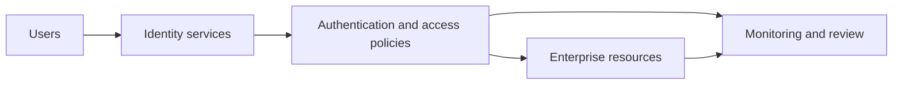

<h1 align="center">kumar3golu</h1>

<strong>IT Professional | Identity & Access Management | Enterprise IT Infrastructure | IT Operations</strong>

---

## Professional summary

IT professional with 7+ years of experience across identity and access management, Azure cloud operations, enterprise infrastructure and technical support.

## Professional experience

| Organization | Role | Period |
| --- | --- | --- |
| Carlsberg Group GCC | Senior Software Engineer – Identity & Access Management | Jun 2025 – Present |
| Teleperformance | IT Support Specialist – Azure Cloud Operations | Jul 2023 – May 2025 |
| HCLTech | Analyst – Infrastructure & Virtualization | Aug 2022 – Jul 2023 |
| Spectra India | Cloud Support Engineer | Jun 2020 – Apr 2022 |
| Microsense | IT Helpdesk Engineer | Aug 2019 – Apr 2020 |

### Career highlights

- Carlsberg Group GCC: Identity lifecycle management, identity governance, hybrid identity, enterprise application access and administrative automation.
- Teleperformance: Azure production operations, incident resolution, resource monitoring and PowerShell automation.
- HCLTech: Server administration, virtualization, backup and recovery, and infrastructure support.
- Spectra India: Virtualization, remote application access and client technical support.
- Microsense: Network infrastructure support, authentication and connectivity troubleshooting.

## Technical skills

| Domain | Technologies |
| --- | --- |
| IAM | Microsoft Entra ID, Active Directory, Entra Connect, MFA, SSO, Conditional Access, RBAC |
| Identity governance | PIM, Access Reviews, Entitlement Management, Joiner-Mover-Leaver lifecycle |
| Authentication and integration | SAML 2.0, OAuth 2.0, OpenID Connect, application registrations |
| Azure operations | Virtual Machines, VM Scale Sets, Virtual Networks, Storage Accounts, App Services |
| Automation | PowerShell, Microsoft Graph API |
| Security and monitoring | Microsoft Defender, Defender for Cloud, Azure Monitor, Log Analytics, Network Watcher |
| Infrastructure | VMware ESXi, Hyper-V, Proxmox VE, server administration, backup and recovery |
| IT operations | Incident resolution, SLA management, application support, Remote Desktop Services, TSplus, RDS-Knight |

## Certifications and credentials

- SailPoint Identity Security Leader Credential
- Saviynt Identity Security for AI Age (ISAA)

## Education

| Qualification | Institution | Year |
| --- | --- | --- |
| MBA – Information Technology | Suresh Gyan Vihar University | 2025 |
| Bachelor's Degree | Delhi University | 2021 |
| Diploma – System & Networking Engineer | Jetking (JCHNE+Cloud v2) | 2019 |

## Identity and access reference architecture

Conceptual reference architecture for learning, not a production deployment.

## Featured repository

**[IAM Zero Trust Lab](https://github.com/kumar3golu/iam-zero-trust-lab)**

## Planned portfolio resources

- Identity lifecycle and access review checklists
- Enterprise directory services operational runbooks
- Incident management and escalation templates
- Infrastructure health check documentation
- IT service improvement and knowledge management guides

## Professional principles

- Security and least privilege
- Reliable IT services and clear operational processes
- Continuous improvement and practical documentation

## GitHub activity

[Repositories](https://github.com/kumar3golu?tab=repositories) · [Contribution history](https://github.com/kumar3golu#js-contribution-activity)

## Collaboration and opportunities

Interested in opportunities and collaboration in IAM, enterprise IT infrastructure, IT operations and operational management.
